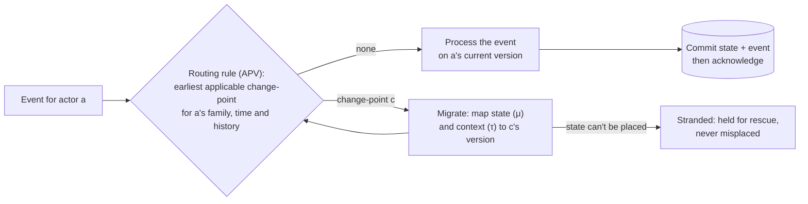

<!--
  StateKeep: self-hosted engine for persistent statechart actors with history-based live version migration.
  Keywords: state machine engine, workflow engine, statecharts, XState v5, durable execution, actor model,
  workflow versioning, live migration, zero-downtime deployment, long-running workflows, SQLite, PostgreSQL.
-->

<p align="center">
  <a href="#-see-it-in-60-seconds">
    <picture>
      <source media="(prefers-color-scheme: dark)" srcset="docs/assets/hero-dark.svg">
      <source media="(prefers-color-scheme: light)" srcset="docs/assets/hero-light.svg">
      
    </picture>
  </a>
</p>

<p align="center">
  <a href="https://github.com/mmujtaba0085/StateKeep/actions/workflows/ci.yml"></a>
  <a href="https://github.com/mmujtaba0085/StateKeep/tags"></a>
  
  
  <a href="formal/"></a>
  <a href="LICENSE"></a>
  <a href="https://github.com/mmujtaba0085/StateKeep/stargazers"></a>
</p>

<p align="center">
  <a href="#-see-it-in-60-seconds"><b>60-second demo</b></a> ·
  <a href="#-quick-start"><b>Quick start</b></a> ·
  <a href="#-how-it-works"><b>How it works</b></a> ·
  <a href="#-how-it-compares"><b>Compare</b></a> ·
  <a href="docs/API.md"><b>API</b></a> ·
  <a href="#-faq"><b>FAQ</b></a>
</p>

---

**StateKeep** runs your workflows as **persistent statechart actors** (orders, loans, onboarding, support tickets, AI agent sessions) and lets you ship **new versions to actors that are already running**.

Each actor moves to the right version based on **the path it took** to get where it is. You don't replay events, write migration scripts, or keep old workers alive.

You define a machine in **XState v5** JSON, deploy it with one HTTP call, and send events. StateKeep stores every actor's state, context (encrypted) and full event history in **SQLite or PostgreSQL**. It survives crashes, and it can run as a **cluster**.

> [!TIP]
> **The one-sentence idea:** two orders can both be `shipped`, but if only one was ever put `on hold`, a fix for held orders should reach only that one. StateKeep makes that a deployment flag: `"historyPath": ["HOLD", "RELEASE"]`.

## 🤔 Why this exists

Once a workflow is live, three problems show up.

| Problem | What usually happens | What StateKeep does |
|---|---|---|
| **Changing logic for in-flight instances** | Hand-written migration scripts that pass staging and fail on years of production edge cases | Every actor is routed to the new version by a deterministic rule, and its state is mapped declaratively |
| **Old versions you can never retire** | v1 workers stay alive until the last v1 instance finishes | Running actors move forward, and old versions empty out and are collected |
| **Instances silently left behind** | Actors keep running stale logic in states that no longer exist | Before you commit, a preview lists exactly which actors would be stranded. They're held for rescue, not misplaced |

## ⚡ See it in 60 seconds

```bash
docker compose up -d                                   # API on :3001, dashboard on /dashboard
sk() { curl -s -H 'content-type: application/json' -H "x-api-key: $STATEKEEP_API_KEY" "$@"; }

# 1. Deploy v1 of an order workflow
sk -X PUT localhost:3001/v1/definitions -d '{"id":"order-v1","definition":{"id":"order","initial":"placed","states":{
  "placed":{"on":{"PAY":"paid","HOLD":"on_hold"}}, "paid":{"on":{"SHIP":"shipped"}},
  "on_hold":{"on":{"RELEASE":"shipped"}}, "shipped":{"on":{"DELIVER":"delivered"}}, "delivered":{"type":"final"}}}}'

# 2. Two orders reach "shipped" by different paths
A=$(sk -X POST localhost:3001/v1/actors -d '{"definitionId":"order-v1"}' | jq -r .id)
B=$(sk -X POST localhost:3001/v1/actors -d '{"definitionId":"order-v1"}' | jq -r .id)
sk -X POST localhost:3001/v1/actors/$A/event -d '{"type":"PAY"}';  sk -X POST localhost:3001/v1/actors/$A/event -d '{"type":"SHIP"}'
sk -X POST localhost:3001/v1/actors/$B/event -d '{"type":"HOLD"}'; sk -X POST localhost:3001/v1/actors/$B/event -d '{"type":"RELEASE"}'

# 3. Ship v2 (held orders need an audit before delivery), only for orders that were held
sk -X PUT localhost:3001/v1/definitions -d '{"id":"order-v2","parentId":"order-v1","historyPath":["HOLD","RELEASE"],
  "definition":{"id":"order","initial":"placed","states":{
  "placed":{"on":{"PAY":"paid","HOLD":"on_hold"}}, "paid":{"on":{"SHIP":"shipped"}},
  "on_hold":{"on":{"RELEASE":"shipped"}}, "shipped":{"on":{"DELIVER":"audit"}},
  "audit":{"on":{"APPROVE":"delivered"}}, "delivered":{"type":"final"}}}}'

sleep 2                                               # the migrate worker moves B in the background
sk localhost:3001/v1/actors/$A | jq .definitionId    # "order-v1"  (paid normally: untouched)
sk localhost:3001/v1/actors/$B | jq .definitionId    # "order-v2"  (was held: now gets the audit step)
```

Both orders were in the same state. Their histories differed, so they got different versions, with no replay and no script.

## ✨ What you get

<table>
<tr>
<td width="50%" valign="top">

### 🧭 History-targeted versioning
Deploy a version for **all** running actors, or only those whose history matches a pattern (`historyPath`, or per-region `historyRegions` for parallel states). Chains of pending versions are followed to a fixpoint.

</td>
<td width="50%" valign="top">

### 🛟 No silent strandings
Removing a state that actors occupy returns a **preview with a confirm token**, not a broken deploy. Map states with `stateMapping` (dotted paths for nested states), reshape context with `contextTransform`, and rescue stranded actors later.

</td>
</tr>
<tr>
<td valign="top">

### 💾 Durable by default
An event is acknowledged only after it's committed. Actors survive crashes, restarts and deploys. Context is encrypted with AES-256-GCM, and the event history is an append-only audit log (unless you turn on optional pruning).

</td>
<td valign="top">

### 🔁 Side effects never silently repeated
Each action has a **delivery mode** (`idempotent`, `verify`, …). When an outcome is unknown after a crash, the action is retried safely or sent to a human for review, never fired twice by accident. [Read more](docs/side-effects.md)

</td>
</tr>
<tr>
<td valign="top">

### 🌐 SQLite → Postgres → cluster
Start with one SQLite file. Switch to PostgreSQL, then run several API servers behind any load balancer. Each actor has one owner, requests are forwarded, and a failed owner is taken over safely. [Read more](docs/multi-server.md)

</td>
<td valign="top">

### 🤖 AI agent sessions
Run an agent loop as an actor with tool calls with retries, human approval states, and **live prompt/policy upgrades for sessions already running**. [Read more](docs/agent-sessions.md)

</td>
</tr>
<tr>
<td valign="top">

### 🧪 Know before you ship
Static analysis on every deploy (unreachable states, dead ends, bad targets), scenario tests, and `statekeep plan`: a *terraform-plan*-style report of what a release does to production actors, also available as a GitHub Action. [Read more](docs/migration-plan.md)

</td>
<td valign="top">

### 🔌 Bring your stack
Guards and actions in **any language** over HTTP, SDKs for **TypeScript, Python and Go**, importers for **AWS Step Functions, SCXML and BPMN**, webhooks, WebSocket streams and a dashboard.

</td>
</tr>
</table>

## 🧠 How it works



* Every deployment registers a **change-point**: *from logical time t, actors of this family whose history matches π go to version d′*. π is either an exact history or "all actors".
* Every actor carries a **history fingerprint**, a length-prefixed SHA-256 chain over the events that changed its state. Storage is constant per actor (one fingerprint, plus one per parallel region) and never grows with the history; routing never scans the log.
* Before each event, the actor is routed to a **fixpoint** through every pending version. Then the event runs.
* A migration places the actor in its landing state **without running entry actions** and without replay, so it never fires side effects ([details](docs/apv.md#what-a-migration-does-and-does-not-do)).

This scheme is called **APV** (*anchor-point versioning*). The core properties of its **routing model** are **machine-checked in Lean 4** ([`formal/APV.lean`](formal/)):
* determinism and progress (routing terminates and never revisits a version);
* completeness;
* safety (an actor is never placed in a state that doesn't exist);
* the parallel-region order;
* the garbage-collection frontier.

The proofs are about the model, not the shipped engine (a compiled WebAssembly module). The engine and the routing code are **differentially tested** against those same Lean definitions run as a program ([`test/test_model_oracle.js`](test/test_model_oracle.js)): the model is proved, and the code is tested against it.

## ⚖️ How it compares

| | **StateKeep** | Temporal | Camunda 8 | XState (library) |
|---|---|---|---|---|
| Workflow model | Statechart (XState v5 JSON) | Code | BPMN | Statechart |
| How in-flight instances get a new version | Routed automatically on their next event, per instance, by history | Keep running the old code; changes via patching/versioning APIs in your code | Explicit migration plans applied to chosen instances | You build it |
| Choose instances by the path they took | ✅ Built in (`historyPath`) | Manual (code branches) | Manual (instance queries) | Manual |
| Preview who'd be stranded before deploying | ✅ With confirm token | — | Validation of the migration plan | — |
| Replays history to restore state | No: state is stored | Yes (deterministic replay) | No | No (snapshots) |
| Minimum to self-host | Node 22 + one SQLite file | Temporal server + database | Orchestration cluster + secondary storage | Your app |

**When to pick what:**
- **Temporal** if your workflow *is* code and replay fits.
- **Camunda** if BPMN and process modelling teams are the center of gravity.
- **StateKeep** if the workflow definition is the product: you need to version it as data, change it for instances already running, and audit it as plain database rows.

## 🚀 Quick start

<details open>
<summary><b>Docker</b> (recommended)</summary>

```bash
git clone https://github.com/mmujtaba0085/StateKeep && cd StateKeep
cp .env.example .env
node -e "console.log(require('crypto').randomBytes(32).toString('hex'))"   # paste as STATEKEEP_ENCRYPTION_KEY
# also set STATEKEEP_ADMIN_KEY and STATEKEEP_API_KEY in .env
docker compose up -d
curl localhost:3001/v1/health          # {"status":"ok",...}
```
Then open `http://localhost:3001/dashboard/` in a browser.
</details>

<details>
<summary><b>Node.js</b> (22+)</summary>

```bash
npm install
cp .env.example .env                   # set the three keys as above
npm start &                            # API server
npm run migrate-worker &               # background migrations
node --env-file=.env src/workers/scheduler-worker.js &   # timers / delayed events
```
Windows works natively. Run `npm install` from PowerShell, not WSL.
</details>

<details>
<summary><b>Embedded</b> (no server)</summary>

Use StateKeep in-process via `statekeep/lib` ([example](examples/embedded-demo.js)). Or add history-based version routing to plain **XState v5** apps with [`@statekeep/xstate-apv`](packages/xstate-apv/), which wraps XState's own persist/restore.
</details>

<details>
<summary><b>Code-first workflows</b></summary>

Write workflows as async functions with [`@statekeep/durable`](packages/durable/). Runs survive crashes, and runs already in progress move to new code versions based on the steps they've completed.
</details>

## 🧰 Ecosystem

| Piece | What it's for |
|---|---|
| [`sdk/`](sdk/) · [`sdks/python`](sdks/python/) · [`sdks/go`](sdks/go/) | Client SDKs (TypeScript, Python stdlib-only, Go) |
| [`packages/durable`](packages/durable/) | Code-first durable workflows on top of StateKeep |
| [`packages/xstate-apv`](packages/xstate-apv/) | History-based version routing for XState v5, no server |
| `statekeep` CLI | `push`, `preview`, `plan`, `import`, `dev` (file watcher) |
| [GitHub Action](examples/github/migration-plan.yml) | Comments a migration plan on every pull request |
| [Importers](docs/importers.md) | AWS Step Functions (ASL), SCXML, BPMN → StateKeep |
| [Remote implementations](docs/remote-implementations.md) | Guards and actions in any language over HTTP |
| Dashboard | `/dashboard`: actors, versions, deployment preview, queues, metrics |

## 🔬 Evidence it works

- **Proofs:** the routing *model* is machine-checked in Lean 4 with no `sorry` and only standard axioms ([`formal/`](formal/)). This covers the model, not the engine binary.
- **Model-vs-code testing:** the live routing code, the deploy-preview code and the analysis driver are compared hop-by-hop with the Lean definitions on random registries.
- **Fault injection:** [`npm run chaos`](docs/chaos-testing.md) and [`npm run chaos:workflows`](docs/chaos-testing.md) run generated workflows while they:
  - kill API servers, workers and services;
  - deploy new versions mid-flight;
  - fire storms of concurrent, duplicate and unknown events.

  Every actor is then checked against a ground-truth model kept independent of the system under test: no lost or duplicated events, no misrouted or misplaced actors. The full campaign ([`scripts/chaos-campaign.sh`](scripts/chaos-campaign.sh)) runs on **SQLite, PostgreSQL and a 2-server PostgreSQL cluster**, at normal and hard intensity. The latest run covered **2,600 actors and 51 live deployments** (2,247 migrations checked), with 41 API-server kills, 20 database-connection drops, 24 service crashes and 42 worker kills: **0 violations** ([results](docs/chaos-testing.md#campaign-results), [raw summary](benchmarks/chaos/summary.json)). All runs were on a single host with generated workflows.
- **Test suites:** unit, property-based, integration, statechart (SC1–SC18), cluster and end-to-end. Run them with `npm run test:all`.

## ⚙️ Configuration essentials

| Variable | Purpose |
|---|---|
| `STATEKEEP_ENCRYPTION_KEY` | 64 hex chars, AES-256-GCM key for actor context (**required**) |
| `STATEKEEP_API_KEY` | Required `x-api-key` for the API. Without it, the server binds to `127.0.0.1` only |
| `STATEKEEP_ADMIN_KEY` | Admin endpoints (`x-admin-key`) |
| `STATEKEEP_DB_PATH` / `STATEKEEP_DB_URL` | SQLite file, or `postgresql://…` |
| `STATEKEEP_CLUSTER=true` | Several API servers on one Postgres ([guide](docs/multi-server.md)) |
| `STATEKEEP_REMOTE_URL` | Your service implementing guards and actions in any language |

Everything else is in [`.env.example`](.env.example) and [`docs/deployment.md`](docs/deployment.md).

## 📚 Documentation

| Start here | Go deeper | Operate |
|---|---|---|
| [Plain-English overview](docs/simple-overview.md) | [APV: the routing model](docs/apv.md) | [Production deployment](docs/deployment.md) |
| [Getting started](docs/getting-started.md) | [Side effects & delivery modes](docs/side-effects.md) | [Cluster mode](docs/multi-server.md) |
| [Developer guide](docs/developer-guide.md) | [AI agent sessions](docs/agent-sessions.md) | [Logging](docs/logging.md) |
| [API reference](docs/API.md) | [XState compatibility](docs/xstate-compatibility.md) | [Chaos testing](docs/chaos-testing.md) |
| [Scenarios: tickets, loans](docs/scenarios/scenarios-index.md) | [Migration plan in PRs](docs/migration-plan.md) | [Importers](docs/importers.md) |

## ❓ FAQ

<details>
<summary><b>What is StateKeep, in one line?</b></summary>

A self-hosted engine that runs statechart workflows as persistent actors and migrates the ones already running to new versions, chosen per actor by the path it took.
</details>

<details>
<summary><b>Do I need to write migration scripts?</b></summary>

No. Added states and changed transitions need nothing. Renamed or removed states need a declarative `stateMapping`. New context fields need a `contextTransform` (copy, constant or default). The preview tells you which you need before anything is written.
</details>

<details>
<summary><b>What happens to an actor sitting in a state the new version deletes?</b></summary>

If there's no mapping for it, the deploy returns `requires_confirmation` with the affected actors and a confirm token. If you confirm, those actors are marked `needs_rescue`. They're never moved into a wrong state. A later rescue deployment (or a periodic sweep) moves them forward.
</details>

<details>
<summary><b>How is this different from Temporal's versioning?</b></summary>

Temporal keeps in-flight workflows on the code they started with and lets you branch with patching or versioning APIs inside your code. StateKeep versions the *definition as data* and moves running instances forward automatically. You choose which instances by their history, without replay.
</details>

<details>
<summary><b>Does it work with my existing XState machines?</b></summary>

Yes. Definitions use the XState v5 JSON format, and the runtime is StateKeep's own interpreter. See [XState compatibility](docs/xstate-compatibility.md). For in-app XState with no server, use [`@statekeep/xstate-apv`](packages/xstate-apv/).
</details>

<details>
<summary><b>Is it production-ready?</b></summary>

It's at v1.1, with extensive automated testing (proofs, model-vs-code tests, fault injection, multi-server tests). Evaluation so far has been on single hosts with generated workflows. If you run it in production, we'd love to hear from you, so please open an issue.
</details>

<details>
<summary><b>Is it open source?</b></summary>

No, it's **source-available**. The code is public under **Apache 2.0 with the Commons Clause**, which is not an OSI-approved open-source licence. You can use, modify and self-host it for any purpose, but selling StateKeep, or a modified version, as a hosted service or product needs a commercial agreement. The APV routing engine ships as a compiled WebAssembly module whose C source is not public. Its routing model is published and proved in [`formal/`](formal/), and the engine is tested against that model.
</details>

## 🤝 Contributing

Issues and pull requests are welcome. Read [CONTRIBUTING.md](CONTRIBUTING.md), then run `npm run test:all`. If you're evaluating StateKeep for a real workload, open an issue describing it. Real-world cases shape the roadmap.

If StateKeep is useful to you, a ⭐ helps other people find it.

## 📄 License

[Apache 2.0 with the Commons Clause](LICENSE). Commercial licensing: [mmujtaba0085@gmail.com](mailto:mmujtaba0085@gmail.com).
