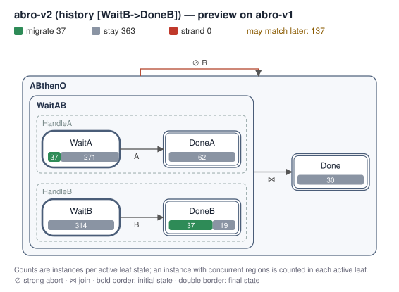
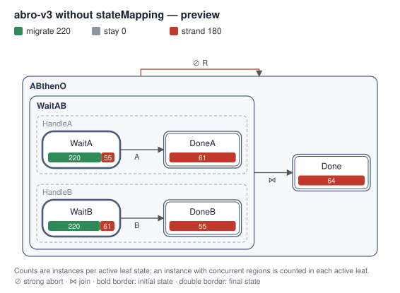
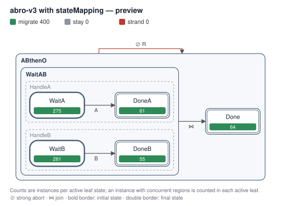

# SCCharts + APV: a prototype

History-targeted live migration for **running SCCharts instances**: when a model changes,
decide per instance, by the transitions it has actually taken, whether it moves to the
new version and where it lands. No replay, no re-running of actions, and an exact
preview, drawn on the chart with the Eclipse Layout Kernel, of what a release would do.

This prototype accompanies a proposal to the KIELER group (Real-Time and Embedded Systems,
Kiel University). It applies the APV routing model ([docs/apv.md](../../docs/apv.md)) to
synchronous statecharts.

```bash
cd examples/sccharts-apv
npm install          # elkjs
npm run demo         # a fleet of ABRO controllers through three releases → out/*.svg
npm test             # 12 tests
```

## Why synchronous languages fit

APV routes an actor in a *unit*, a step during which nothing else happens to it. In a
synchronous language that step exists by construction: **between two ticks an instance
is quiescent**. Routing happens there, before each reaction, so a release is applied
atomically with respect to the instance's behaviour, and the deterministic semantics
make the history of transitions a precise record of what the instance has done.

| APV concept | Here |
|---|---|
| Actor | A running SCChart instance (configuration, outputs, logical time) |
| Event unit | A tick: route to a fixpoint, then react |
| History | The transitions taken, as ids `Source->Target` (outer before inner, regions in order) |
| Fingerprint | StateKeep's v2 chain (length-prefixed SHA-256) over those ids |
| Change-point | A release: (chart, time, history pattern or wildcard, target version, state mapping) |
| Migration | Map every active leaf (dotted keys, longest prefix); new regions start in their initial state; no entry actions; outputs and history kept |
| Stranding | A configuration that can't be placed: the instance stops reacting until a later release places it |
| Preview | Exact for current instances; instances that may match later are flagged, with the leaves the mapping can't place |

## The demo

400 ABRO controllers (emit `O` once `A` and `B` have both been present; `R` restarts)
run for a few ticks, then three releases:

1. **v2, history-targeted.** Only controllers whose *whole* history is
   `[WaitB->DoneB]` (B seen, A pending, never reset) get a backup input `T` for A.
   In the preview, `DoneB` holds controllers in the same state with different
   histories: the ones that got there by exactly that path migrate, the others stay.
   Controllers with an empty history may match later; they move at the tick after they
   reach the pattern.

   

2. **v3 without a state mapping.** v3 renames `DoneA`, `DoneB` and `Done` and adds an
   acknowledgement step. Without a mapping, every controller in a renamed state would
   strand, so the deployment is refused until those exact controllers are consented to.

   

3. **v3 with the mapping** places every controller; after deployment the new
   acknowledgement step works on the migrated controllers.

   

## Files

| File | |
|---|---|
| `sctx.js` | Parser for a subset of the SCCharts textual syntax |
| `tick.js` | Synchronous reactions for that subset |
| `apv.js` | Registry, routing rule, migration, stranding, preview, consent |
| `diagram.js` | Migration preview as SVG, laid out by elkjs |
| `models/abro-v*.sctx` | The three versions |
| `demo.mjs`, `test.mjs` | Demo and tests |

## Limits of this prototype

* **Language subset.** Boolean inputs and outputs, states, superstates, concurrent
  regions, `immediate`, `go` / strong `abort` / `join`, entry/during/exit actions and
  boolean triggers. No valued variables, `pre`, count delays, history transitions,
  suspension, references or `for` regions; those are reported as errors.
* **Simplified semantics.** No causality analysis and no sequential constructiveness for
  shared variables. This is a semantics to study versioning with, not a replacement for
  KIELER's compiler. The research question is how APV composes with the real SC model of
  computation (see the proposal).
* **History vocabulary.** Transition ids name states of the version where the transition
  was taken; after a rename, older history entries keep the old names. Stable transition
  identities across versions are one of the open questions.
* **Scalar patterns only.** Regional selectors (StateKeep's `historyRegions`) are not
  implemented here; with concurrent regions they are the natural next step.
* **In-process.** Instances live in memory; persistence, clusters and the private APV
  engine are StateKeep's job.
